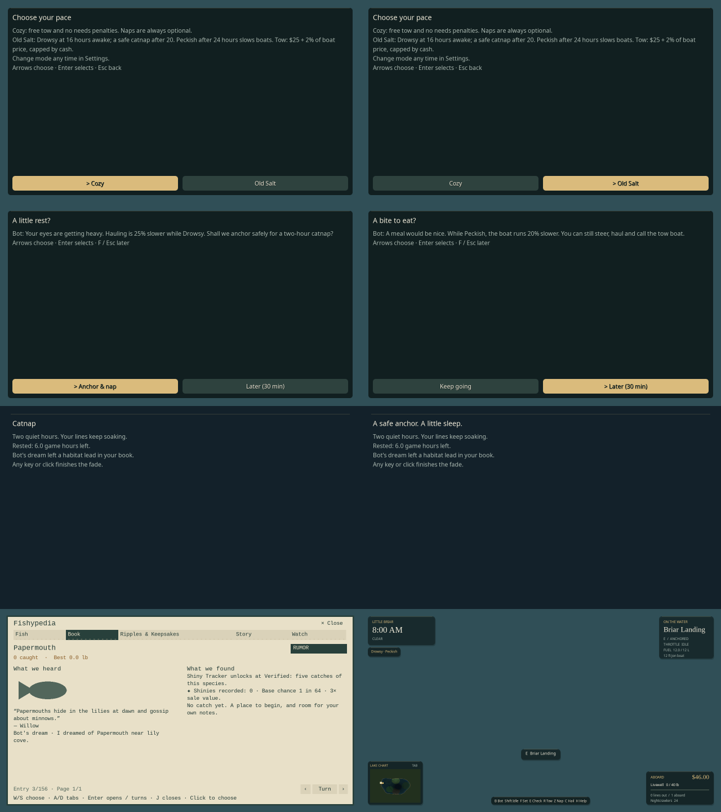

# V1-14 — modes, catnap and needs

Issue: [#42](https://github.com/AventurineDream/Trotline-Purridise/issues/42).

New Game defaults to Cozy and lets the player select Old Salt before replacing
the save. Settings switches either way immediately, resets routine counters and
retains Rested, dream history and the shared prompt throttle.

## Acceptance evidence

- Cozy ignores stale need counters: normal speed, normal hauling, no needs
  prompt or forced nap, and free tow.
- Old Salt becomes Drowsy at 16 awake hours, dozes strictly after 20, and becomes
  Peckish strictly after 24 hours without a meal. An already-due doze anchors
  before the next driving step. The nap stops propulsion and safely advances
  two hours once; skipping its fade cannot advance it again.
- Needs and Rested freeze in menus, on focus loss and offline. Need invitations
  share a saved ten-minute active-real-time throttle; Later snoozes that need
  for thirty active real minutes.
- An eligible nap grants six active game hours of Rested and one saved,
  deterministic habitat lead when a species is available. One unread lead
  waits at a time. Reading it keeps its heard note and frees the unread slot.
- 10,000 seeded tow cases cover both modes, every boat and empty wallets. The
  Old Salt quote caps at available cash, money never goes negative, the boat
  reaches the landing, and boats and livewell contents remain intact. The
  existing idle/sail-down prerequisite is unchanged.
- New-game cancellation preserves the save. Keyboard, mouse and controller
  paths select a mode and start a nap. Native text bounds checks cover both
  fonts, all three text sizes, and 1280×720 / 480×270 dialogs without overlaps.

The focused local command passed **119 tests**:

```sh
python -m unittest fishing.test_comfort fishing.test_world_pause fishing.test_settings fishing.test_haul fishing.test_book fishing.test_bookview fishing.test_shinies fishing.test_content_v2 fishing.test_catches fishing.test_ui_layout -q
```

The full unit/persistence suite and software self-test run in `gameplay-tests`.
This local source mirror lacks the Cedar terrain binary, so the complete
two-lake suite is verified by CI against the repository assets.

`comfort.meal(v2)` clears hunger for the kitchen/snack integration in V1-15;
pantry and meal content are part of that next ticket.

## Visual evidence and performance

`python -m fishing --shots` includes `comfort_gallery` alongside the existing
lake and book captures. These committed fixtures call the same gallery with a
plain water background so the UI can be inspected independently.



Compact captures use the largest accessibility font:

- [Mode selection](comfort-mode-old-salt-compact-accessible.png)
- [Drowsy prompt](comfort-drowsy-prompt-compact-accessible.png)
- [Peckish prompt](comfort-peckish-prompt-compact-accessible.png)
- [Catnap](comfort-catnap-compact-accessible.png)
- [Dream entry, all three pages](comfort-dream-entry-compact-accessible.png)
- [1280×720 routine HUD](comfort-routine-hud-accessible.png)

The [benchmark report](comfort-benchmark.json) measures 140 warmed frames at
1280×720 with the largest accessibility font: **11.58 ms p50**, **15.88 ms p95**,
**173.5 MiB peak RSS**, and the existing bounded **8 MiB** text cache. It includes
new dialog composition and Drowsy edge softening; it excludes lake rendering.
Dialog wrapping uses a bounded 64-entry LRU. This is a UI composition check,
not a measurement of complete game frame time.
