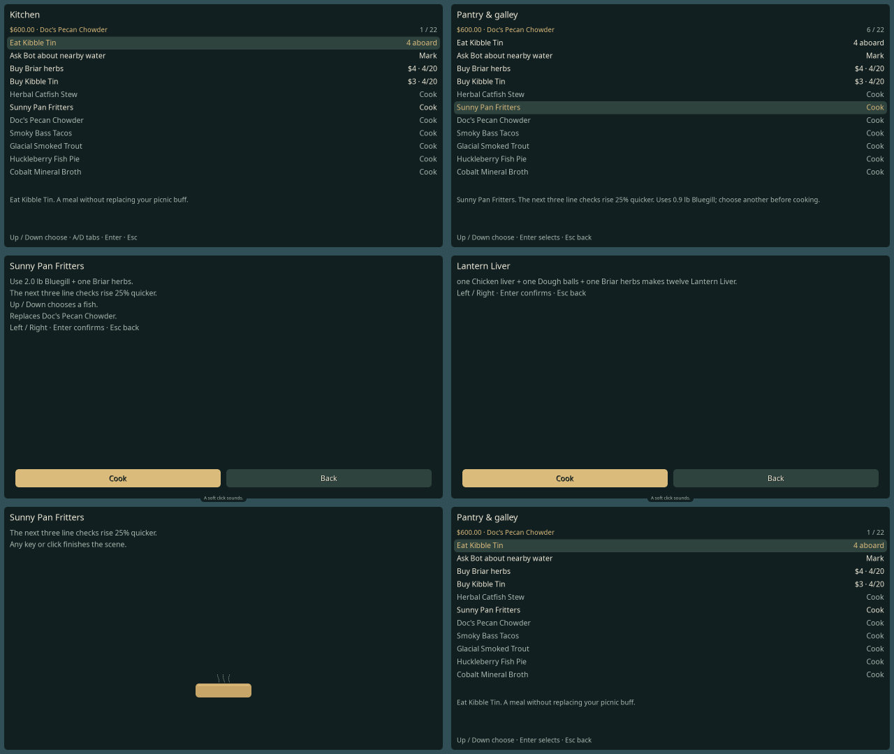
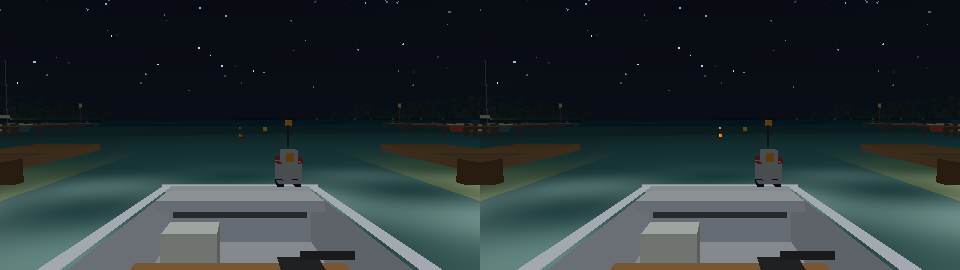
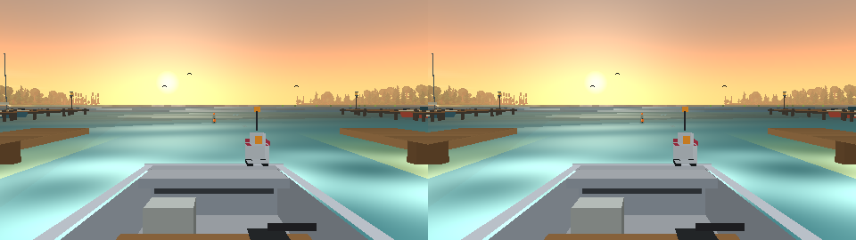

# V1-15 — pantry, kitchen, dishes and recipe baits

Issue: [#43](https://github.com/AventurineDream/Trotline-Purridise/issues/43).

The landing shop has a Kitchen tab. K opens a pantry on any boat; cooking
requires a landing or an anchored galley, while Kibble Tins can be eaten on
every boat. Pause → gamepad Y opens the same menu. The hunger invitation also
offers an aboard snack. All six items, ten dishes and eight bait recipes are
validated data. Each host sells its specialty and Kibble Tins, capped at 20
per item. Known dish cards cannot be bought twice.

## Acceptance evidence

`test_kitchen.py` adds 24 acceptance/regression tests covering every buff:

| Dish | Verified effect |
| --- | --- |
| Herbal Catfish Stew | Bot adds two factual likely species; no RNG consumed |
| Sunny Pan Fritters | Next three checks rise 25% quicker, including the third; opening or unfocusing the view spends no charge |
| Doc's Pecan Chowder | Actual engine fuel burn ×0.75, with unchanged propulsion |
| Smoky Bass Tacos | One extra favorable-water invitation today, capped even after another meal; quiet when none is favorable |
| Glacial Smoked Trout | Actual scout target range ×1.25 outside snow mist; snow-mist gust push suppressed |
| Huckleberry Fish Pie | Next nap queues a new dream while preserving an unread lead and Rested; consumed once |
| Cobalt Mineral Broth | Fog thins within 150 m; software and GL frames change |
| Ember Hotpot | Empty hooks retain/restore bait on the next three checks; unbuffed hooks unchanged |
| Moon-Milk Pudding | An extra pity credit for each tracked ordinary fish on an affected check, once per fish across reloads; existing catches never reroll |
| Starlight Soup | Buoys glow on the water and chart; the Old Salt meal lasts 48 h, beyond the six-hour light |

Additional checks cover one buff replacing another, smallest-first fish choice,
manual selection, and rejection of shiny (even untreasured), Treasured,
protected and legendary fish. Cancelling consumes nothing. Recipes require
both parent pieces and an ingredient, produce twelve pieces, reject overflow
atomically, and take the better parent match for every species. Pantry, recipe
knowledge, buffs and future fields round-trip through saves. Duration buffs
freeze in menus, focus loss and offline. Haul charges are saved at the first
raised hook or direct check.

The original five bait-match maps and 360 sampled ordinary rate tables retain
their baseline fingerprints. Seeded no-buff fishing matches a save with an
unknown future buff; no rate modifier was added.

**157 selected local unit/persistence/UI checks passed**, plus the final 38
kitchen/comfort checks after preserving the 48-hour meal through a mode switch.
The two Cedar migration methods require the terrain binary absent from this
local source mirror; the complete suite and software self-test run in CI against
the repository assets. Native bounds checks cover both fonts, three text sizes,
1280×720 and 480×270, including captions, without text overlap.

OpenGL shader compilation and fog/glow frame comparisons passed on Mesa
llvmpipe (LLVM 23.1.3). These are functional checks, not hardware performance
claims. Software comparisons below use the ordinary lake renderer.

## Content and integration

Host teaching follows the saved chapter cursor; $40 cards follow completion.
Recipe cards are learned by hailing their clue teller. Later chapter, host and
food-species content uses these interfaces; the kitchen does not fabricate story
progress or introduce the later lakes. The current Briar/Cedar landings sell
their specialties and snacks. Regional bait stock and all recipe definitions
are ready for their matching lakes.

Pudding awards bonus progress at a check because ordinary shiny rolls already
happen during soaking. An earned guarantee applies to the next new catch.
The saved per-fish marker prevents reopening a line or reloading from granting
the same bonus twice. Pie's extra lead waits in `book.dream_queue`; the ordinary
unread slot remains first. Soup's meal allowance lasts until another meal and
survives mode changes independently of the visual buff.

## Screenshots and performance

`python -m fishing --shots` includes the kitchen gallery. These standalone
fixtures use a plain background to show the UI independently of lake rendering.

Compact captures use the largest accessibility font:

- [Scrolling menu](kitchen-dish-menu-compact-accessible.png)
- [Fish choice, replacement notice and caption](kitchen-fish-choice-compact-accessible.png)
- [Recipe bait](kitchen-recipe-bait-compact-accessible.png)
- [Steam and bowl](kitchen-cooking-compact-accessible.png)

Ordinary rendering is on the left; the buff is on the right:

The [140-frame warmed UI benchmark](kitchen-benchmark.json) at 1280×720 with the
largest accessibility font reports **9.30 ms p50**, **10.48 ms p95**, **173.3 MiB
peak RSS**, and the existing bounded **8 MiB** text cache. It includes menu
scrolling, confirmations, captions and steam; it excludes lake rendering.
