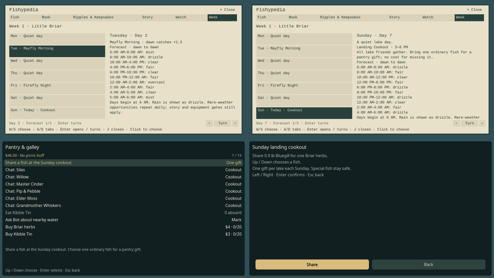

# V1-16 calendar evidence

Closes issue #44. Briar/Cedar receive their four Lake Day modifiers, seven-day
forecasts, Sunday landing gatherings, safe fish sharing and daily Bot invitations.
All twelve legendary weather/clock opportunities are planned for five lake IDs;
future terrain, encounters and expanded rosters remain with their own tickets.

The gallery also includes each panel at 1280×720 with normal and large
accessibility text, plus 480×270 with large accessibility text. Enter/Turn pages
long forecasts; Up/Down selects the day. `python -m fishing --shots --software`
regenerates the matrix through `calendar_gallery`.

Validation:

- `python -m fishing.content` passes the calendar and existing content schemas.
- `test_calendar.py` covers 1,000 seeded weeks × twelve legendaries × two
  fractional eligibility instants: 24,000 complete two-hour opportunities within
  three game days. Reload, lake binding, rollover, atomic cookout claims, safe
  fish choices, paused/focus/offline behavior and forecast pagination are covered.
- Existing book font/bounds checks include the sixth tab. The reference data/RNG
  fingerprint remains pinned under the original weather input; the calendar's
  state-aware simulation integration has a separate regression.
- Software and OpenGL (Mesa llvmpipe) render smoke checks cover mist, rain,
  daytime, Sunday and both sides of a week seam with finite non-flat frames.
- `calendar-benchmark.json`: 140 warmed UI compositions, 1280×720, large text and
  accessibility font; 14.73 ms p50 / 18.59 ms p95, 175.5 MiB peak RSS, 8.39 MB
  bounded text cache. This measures menu composition and excludes lake rendering.

Local full discovery is limited by the absent `fishing/assets/cedar.npz` in this
workspace. The PR's full GitHub validation uses the preserved committed asset and
runs discovery, narrative regressions and `--selftest --software`.
