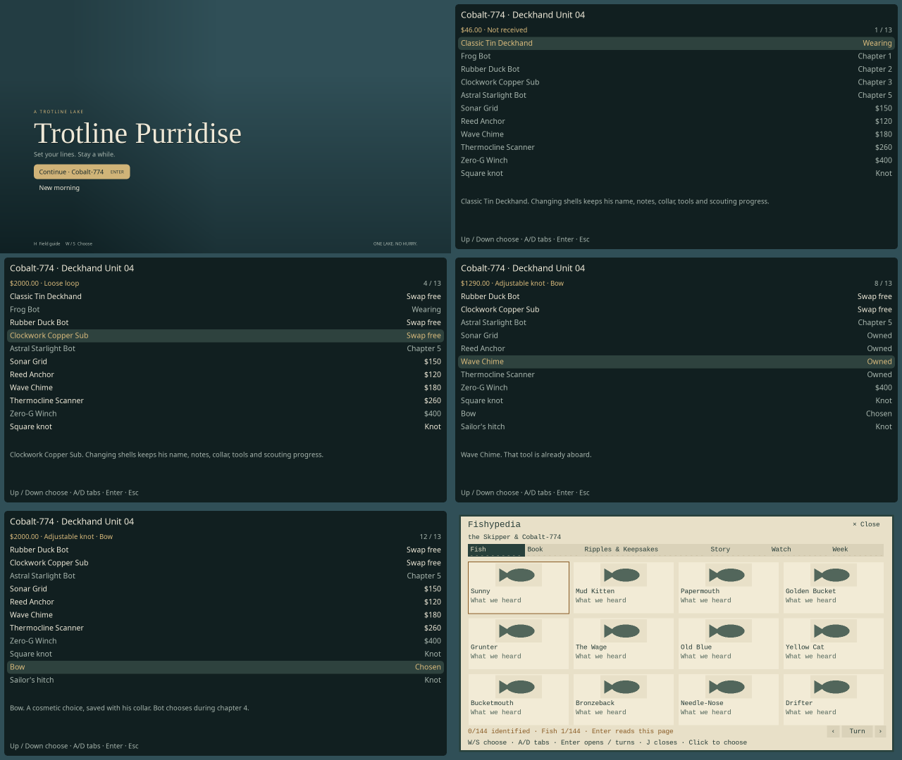

# V1-17 Bot identity evidence

Issue #45 adds deterministic saved names, earned-shell swaps, tool purchase
requirements, collar state and cosmetic knot choice. Individual tool effects
belong to V1-19/V1-20; shell geometry and chimes belong to V1-18.

The gallery includes normal and large accessibility text at 1280×720, plus
480×270 accessibility layouts. Regenerate it with `python -m fishing --shots
<directory> --software` or `botview.bot_gallery`. Snapshot states share the same
world and do not load multiple terrain copies.

Validation:

- `python -m fishing.content` passes all content schemas, including `bot.json`.
- 71 focused regressions cover identity, content, font/layout, controls and
  settings. The 18 identity tests include all 12 prefixes over 2,000 signed
  seeds, suffix bounds, migration/reload, valid-name preservation, future fields,
  shell/scout-memory preservation, tool gating/duplicate charges, all three knots,
  story/visibility independence, dialogue placeholders, landing input and the
  existing Bot scouting checks.
- 29 additional focused checks pass after preserving the compact quest overview,
  including legacy unknown-field roundtrips and collar visibility.
- The local full discovery is limited by this workspace's missing Cedar binary
  terrain. Full GitHub validation uses the preserved committed asset and runs
  discovery, narrative regressions and the software self-test.
- Warmed Bot-menu benchmark: 10.24 ms p50 / 11.12 ms p95, 140 frames at
  1280×720 with large accessibility text, 175.5 MiB peak RSS and
  8.38 MB bounded text cache. This measures shell/tool/collar menu
  composition and excludes lake rendering.
