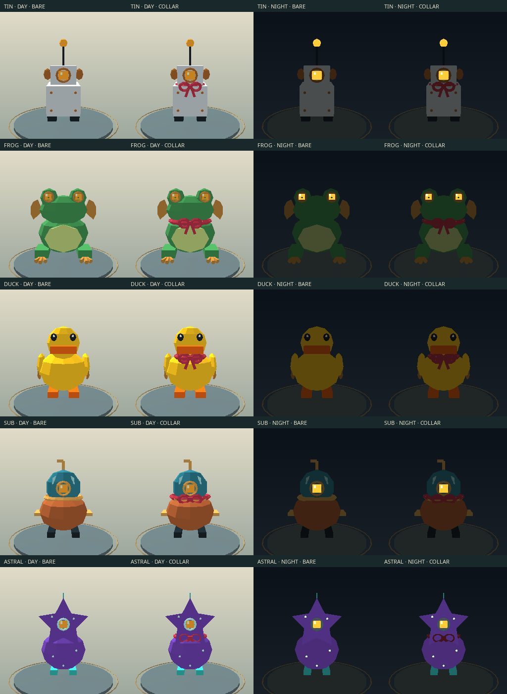
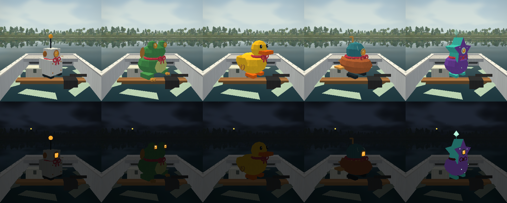
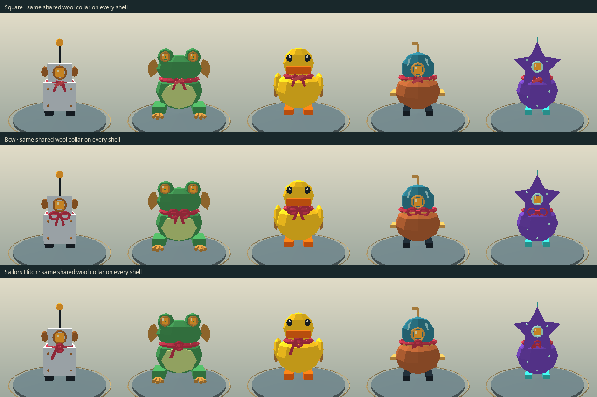

# V1-18 Bot shell art and sound

Issue #46 adds five procedural models, shared knitted collar/knots, scout rig
motion, captioned shell voices and Astral night glow in both renderers.

Each `bot-turntable-<shell>-<day/night>-<bare/collar>.png` strip contains front,
right, rear and left views (0°, 90°, 180°, 270°). `--shots` regenerates all twenty
strips through `botshots.bot_shell_gallery`. The same geometry feeds both backends.

The native comparison was captured on Mesa llvmpipe. Ten floating-point scene
checks (five shells × day/night) were finite. Disabling Astral emission at night
reduced the scene's RGB sum by 1,021,645, confirming the material path is active.
The software preview separately verifies emission has no daytime contribution.

`bot-scout-motion.png` shows three animation phases for each shell. Home poses
remain still; reduced motion freezes the decorative rig while scout travel works.
The collar visibility setting and story stage still control whether wool appears.

Chime samples (mono, 22,050 Hz; all captioned in game):

- [Tin triangle](bot_tin.wav)
- [Frog wooden click](bot_frog.wav)
- [Duck squeak](bot_duck.wav)
- [Sub bubbly tick](bot_sub.wav)
- [Astral glass bell](bot_astral.wav)

Validation includes eleven new geometry/audio regressions: all thirty cached
shape variants finite and bounded; distinct knots; stationary bow and animated
scout poses; reduced motion; shell/boat perch bounds; state/RNG preservation;
explicit non-lamp Duck material; night-only glow; five distinct quiet PCM voices;
matching captions/mixer routing; and landing swap cues. The 45 existing Bot
identity/settings/book checks pass. Local discovery is limited by the absent
Cedar binary terrain; full CI uses the preserved committed asset.

Incremental resources (`bot-shell-memory.json`): 2.867 MiB RSS growth in
the gallery probe, 5.223 MiB in a cold standalone probe, both below the 10 MB
limit. Traced Python/NumPy peak: 1.288 MiB; retained:
0.723 MiB. Twelve mesh-cache slots, maximum 802
quads, and 104,958 bytes for all five cached voices. Rig transform times
under allocation tracing: 7.838 ms p50 / 10.216 ms p95
across 90 warmed frames. Renderer/context and gallery image buffers are
excluded from these incremental measurements.
