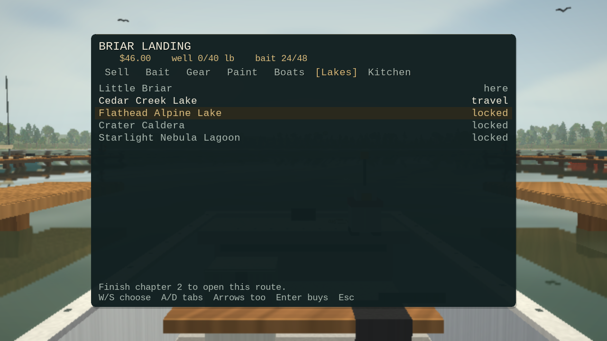
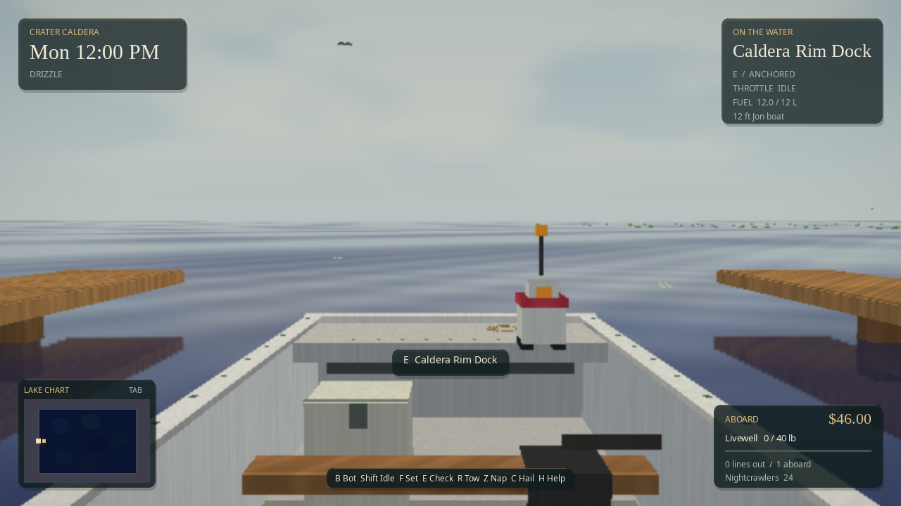
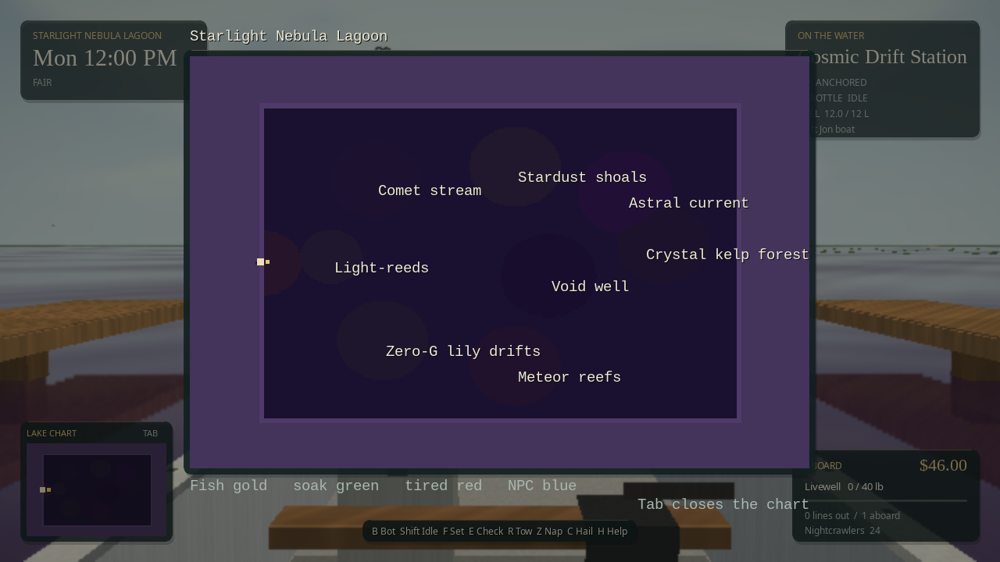
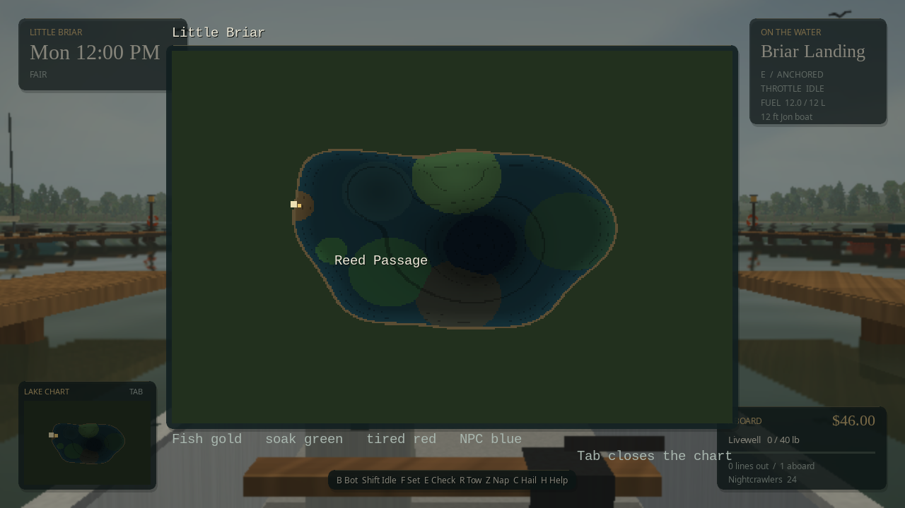
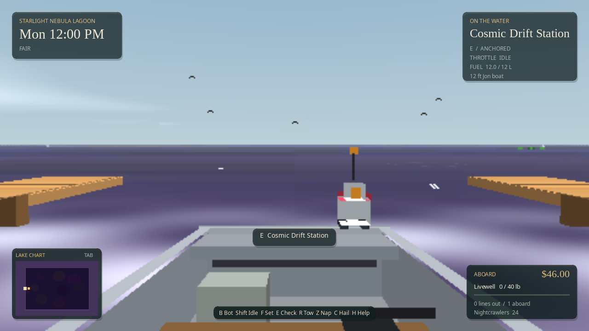

# V1-23 — Five-water framework (issue #51)

All five destinations now have validated lake metadata, habitat IDs, labels,
water/land palette stubs, chapter gates and two Lake Day references. The calendar
owns the effects, including the six new specials. The first eight habitat indices
and Briar/Cedar fishing rates remain unchanged. Briar gains the Reed Passage;
Crater's flat map has springs and no inlet; Nebula has light-reeds and current.

Flathead, Crater and Nebula are intentionally flat, bounded systems maps. Their
ordinary fish rosters are empty, so they cannot accidentally catch Briar species.
Their NPC casts are empty too. Their dedicated terrain, fish, sky spectacles and
story chapters belong to later tickets. Completing chapter 2/3/4, represented by
`v2.story.chapter` advancing beyond that chapter or by `completed_chapters`, opens
Flathead/Crater/Nebula. Briar and Cedar remain available from the start.

Travel still requires a stopped boat at the landing and every deployed line
pulled. It is free and carries gear, saved story state and forecasts. Captions
follow `05 §10`, including returning from Nebula. A failed map construction leaves
the current session intact. The native renderer accepts maps with no foliage;
the play loop releases its initial world reference after changing lakes.

## Validation

`fishing/test_lakes.py` adds 15 regression tests: story gates and invalid values,
menu availability, blocked travel, construction failure, all placeholder habitats,
launch lanes for every current boat, Reed Passage/old anchors, absent future casts,
old-map collection, save/gear/forecast round trips, captions/line labels, malformed
registry diagnostics, all ten Lake Days, CPU habitat rendering and native empty
foliage rendering. The final test drives all **20 directed routes** with real
World/Session instances and checks the destination's fresh actors and docking.
The 1,000-seed × twelve-legendary × two-instant forecast regression still passes.

Local focused tests: 41 passed; after the final chart-label addition, all 32
UI, pause and framework tests passed. Full local discovery also ran: its only errors were the absent `fishing/assets/cedar.npz`
(12 errors, including the new five-water route test); the asset is preserved from
the verified remote base tree. Full GitHub `gameplay-tests` runs the complete
suite and software gameplay self-test with the real Cedar binary. Native tests
skip only when standalone EGL is unavailable. CI results are linked in the PR.

## Chart compatibility

[Raw comparison](chart-comparison.json) samples the exact main base
`05d58a780e5b87816cd78e3c30117270b696db3a`. Briar's complete baked height grid,
sampled shoreline and sampled depths are byte-identical. Exactly **267 baked
chart pixels** changed, all inside the Reed Passage; none outside it changed.
The large chart adds only its new passage label. Cedar's survey asset, metadata,
zone positions and labels are unchanged. Its original binary Git blob is
`c9df54cbbece17a4b9574ad9bf0ad86a0902d624`.

## Captures and warmed measurements

These commands generated the linked native OpenGL/Mesa and CPU outputs:

```sh
python -m fishing --shots docs/issue-51/native --lake-framework --lakes=briar,flathead,crater,nebula
python -m fishing --shots docs/issue-51/software --lake-framework --lakes=briar,flathead,crater,nebula --software
```

Omit `--lakes=...` on a complete checkout to capture all five waters. The explicit
subset here records that Cedar's binary is unavailable locally; it does not
replace full five-water gameplay CI. Each backend captures day/night water,
large charts and locked/open routes. PNGs were inspected for readable labels.

| Lake | Native median ms | Native p95 ms | CPU median ms | CPU p95 ms |
| --- | ---: | ---: | ---: | ---: |
| briar | 103.01 | 120.81 | 295.55 | 317.48 |
| flathead | 64.08 | 77.14 | 144.44 | 162.93 |
| crater | 65.17 | 78.08 | 143.68 | 167.73 |
| nebula | 64.42 | 77.72 | 145.35 | 159.87 |

Both runs use 9 warmup frames, then 60 full frames per lake across play, chart and
Lakes-menu modes, including rendering, 1280×720 resizing and UI composition.
Native rendering is **Mesa llvmpipe (LLVM 23.1.3), 640×360**, CPU rendering is
480×270. These are software-rendered measurements, not hardware-GPU frame-rate
claims. Peak process RSS is **361.23 MiB native** and
**175.90 MiB CPU**, below the 3 GB cap. Each native
scene holds 36 persistent graphics objects with no frame-loop growth. All three
placeholder loops add zero resident bytes after warmup. All four closed worlds
were collected in each run; no previous terrain is cached. The native run also
passes 16 floating-point scene probes at idle/under power.

[Native raw metrics](native/benchmark.json) · [CPU raw metrics](software/benchmark.json)






