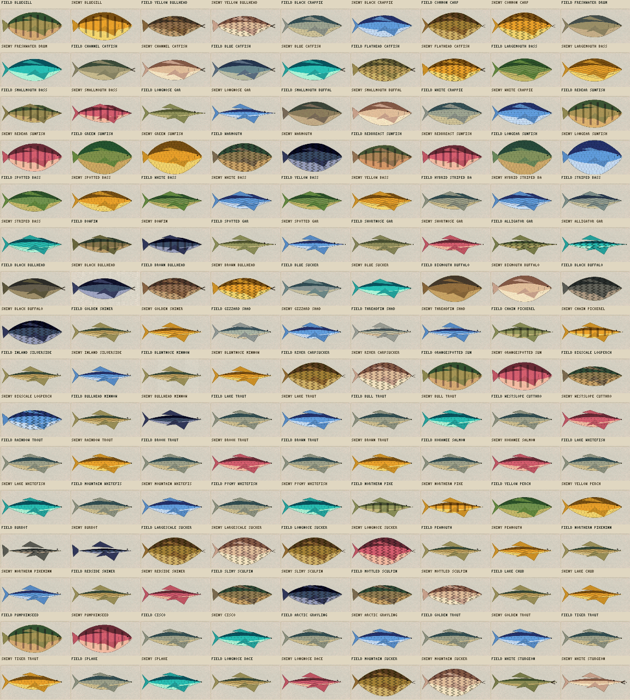
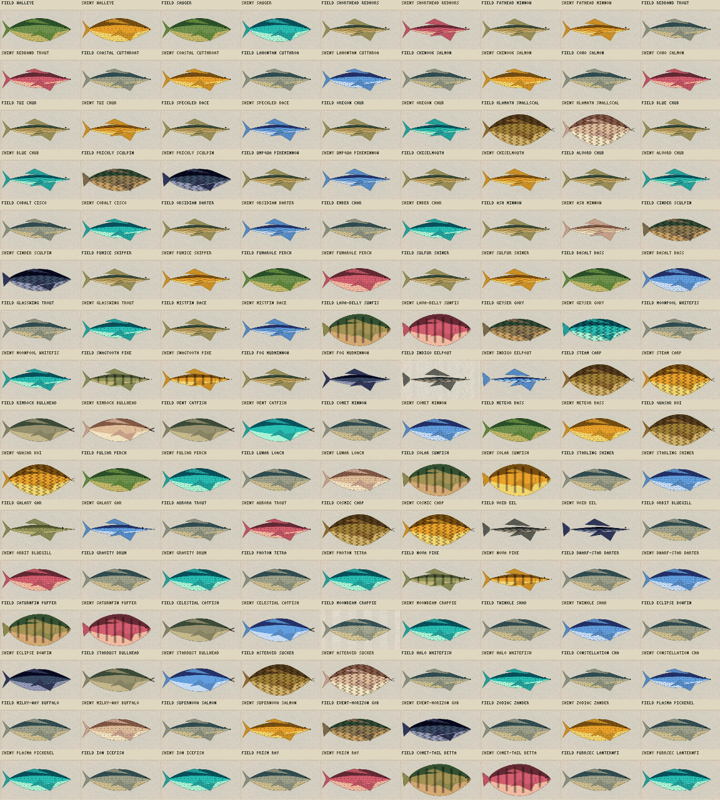
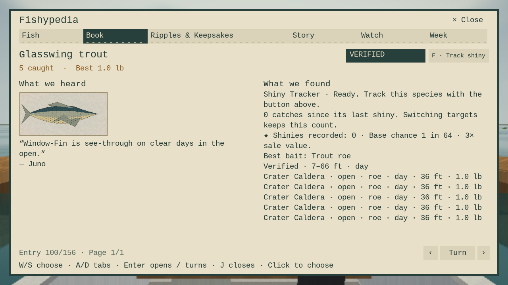
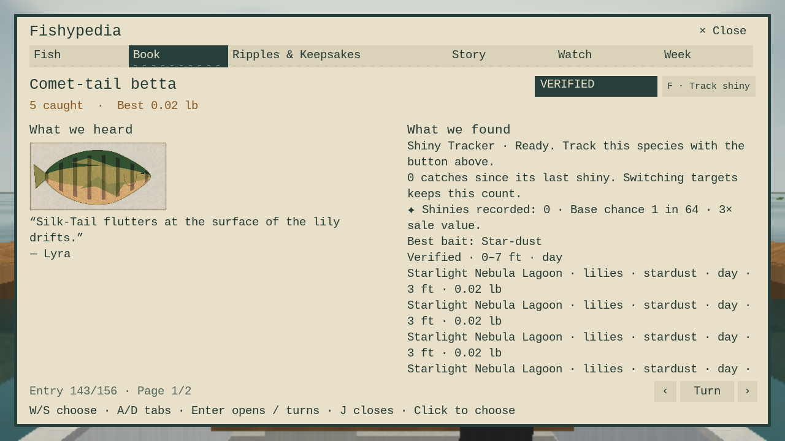
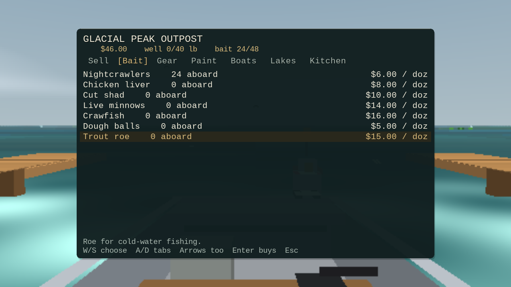

# V1-24 — 108 new fish (issue #52)

The standard roster is now **144 fish**: Briar 36, Cedar 36, Flathead 34,
Crater 34 and Nebula 34. The six Cedar additions occur only there. New rows copy
all fields from the canonical tables: tier/rate/trophy defaults, names and folk
names, sizes, prices, time bands, ordered baits/habitats, food, tags, shiny
palettes and weather affinities. Their attributed rumors were already authored
in the Book manifest and now match catchable species. Bounded looks use the
shared eleven-family geometry system, including trout, sculpin, eel and cosmic
profiles; every new normal/shiny card can render.

## Compatibility and catchability

[Baseline hashes and affinity snapshots](baseline.json) pin the original 36
species rows, the original five bait maps, all legacy habitat matches and Cedar
rates. Those values stay unchanged. The existing seeded Briar catch sequence and
360-table base-rate fingerprints remain pinned. Save migration adds blank
journal entries for new species and keeps existing records and future fields.
Protected fish have zero price and are released even if Keep is requested.
Tiny weights now display enough decimals to show a 0.005 lb fish accurately.

Two legacy shad previously had only a 0.3 best bait match. **Roe now supplies an
explicit 0.6 secondary match for gizzard and threadfin shad**, preserving their
species rows and every original bait profile. Roe is sold at Flathead/Crater and
can travel back to Briar. The other specialty stock remains dough everywhere,
ember grubs at Crater and star-dust at Nebula, at their canonical prices.

New rows declare `baits`, `zones` and `weather_affinities`; the validator checks
ordered preferences against global match tables and available lake habitats,
valid weather/multiplier ranges, exact 144 count and reciprocal rosters. The two
fog species and glasswing trout receive ×1.4 in their stated condition, else
×1.0. Every Nebula fish receives ×1.25 during aurora.

The three flat maps gain provisional `placeholder_depths`, taken from the new
rosters' habitat depth ranges. Dry terrain stays flat, and Briar/Cedar depths
stay unchanged. Real soundings let deep-water species meet the catchability
criterion before their environment tickets land.

`specieschecks.py` floods a four-metre navigation grid from the landing, with
5.8 m hull/edge clearance, full draft and real dock/prop obstacles. It queries
live fishing rates at actual reachable coordinates and depths with available
ordinary bait. Every standard species must have at least one ≥0.5× authored-rate
witness across its home lakes; the legacy rows keep their explicit rate
overrides. We also retain witnesses for every lake/roster pair, including the
weaker Cedar populations. No RNG is consumed. Unit tests and the full software
gameplay self-test both run the complete five-water check.

Local [witness data](local-catchability.json) covers **138 unique fish** in Briar
and the three flat waters, minimum best-rate ratio **0.6**. Cedar's NPZ is absent
locally and stays preserved in the verified Git base tree; full GitHub gameplay
validation checks its six additions and all **174 lake/species pairs**.

Nine new regression tests cover canonical transcription and rumor attribution,
legacy hashes, lake counts, weather/tier rules, specialty stock and travel,
protected release, schema diagnostics, tiny weights and real catchability.
Local focused tests passed (34 cases); full local discovery was also run and
its missing-Cedar cases are delegated to complete GitHub CI. CI results are
linked in the PR. The benchmark journal schedule now covers 144 fish in the
existing 1,200-frame run.

## Visual evidence and allocation measurements

```sh
python -m fishing --shots docs/issue-52/native --species
python -m fishing --shots docs/issue-52/software --species --software
```

Each command renders **288 normal/shiny cards**, new Book entries, roe stock and
the new placeholder soundings. Then it warms 12 full frames and measures 60
frames across those Book/stock/chart views, including lake rendering, resize and
UI composition. Both runs present at 1280×720. Native is Mesa llvmpipe, with an
internal 640×360 render; CPU fallback renders at 480×270. These are software
measurements; hardware-GPU frame rates are unmeasured.

| Backend | Median ms | p95 ms | Peak RSS MiB | CPU card cache MiB |
| --- | ---: | ---: | ---: | ---: |
| Native Mesa | 69.03 | 79.64 | 305.41 | 18.00 |
| CPU fallback | 150.66 | 165.44 | 174.89 | 19.12 |

Both peaks are below the 3 GB cap. The 48-entry card cache stays below its 25 MB
budget, with 36 stable native graphics objects during the warmed loop. Captures
were inspected for legible Book notes, correct tiny weights and stocked bait.

[Native metrics](native/benchmark.json) · [CPU metrics](software/benchmark.json)






