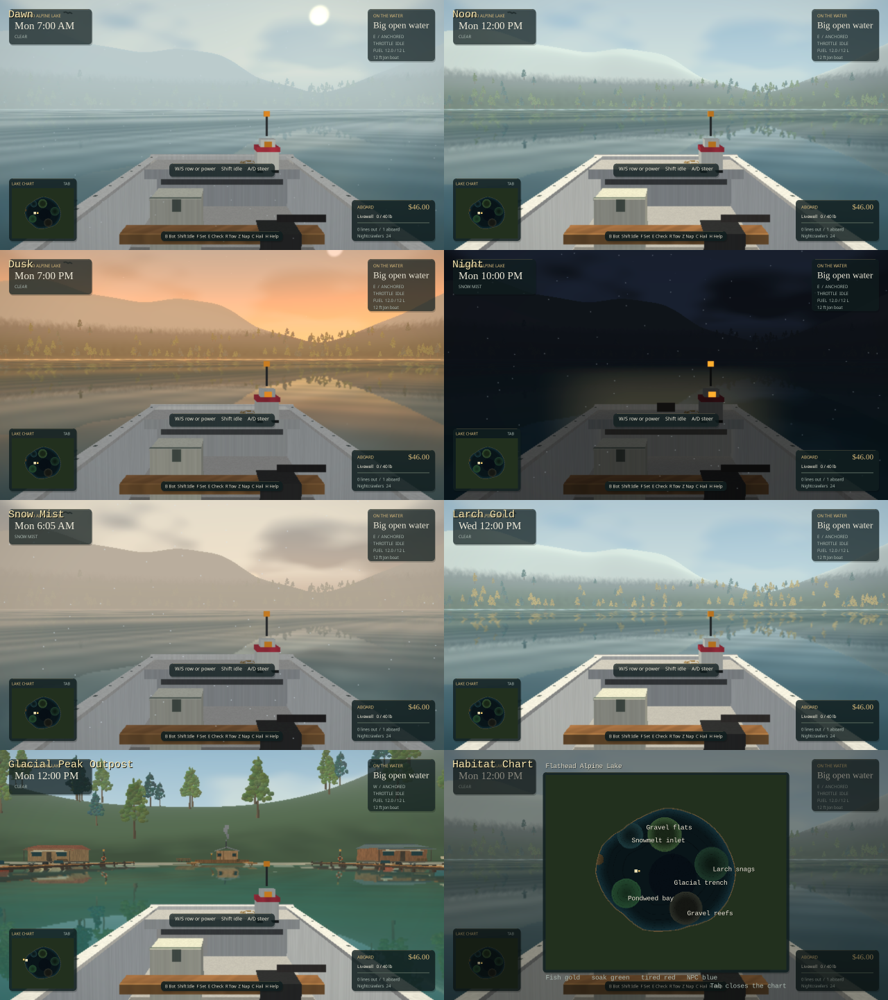
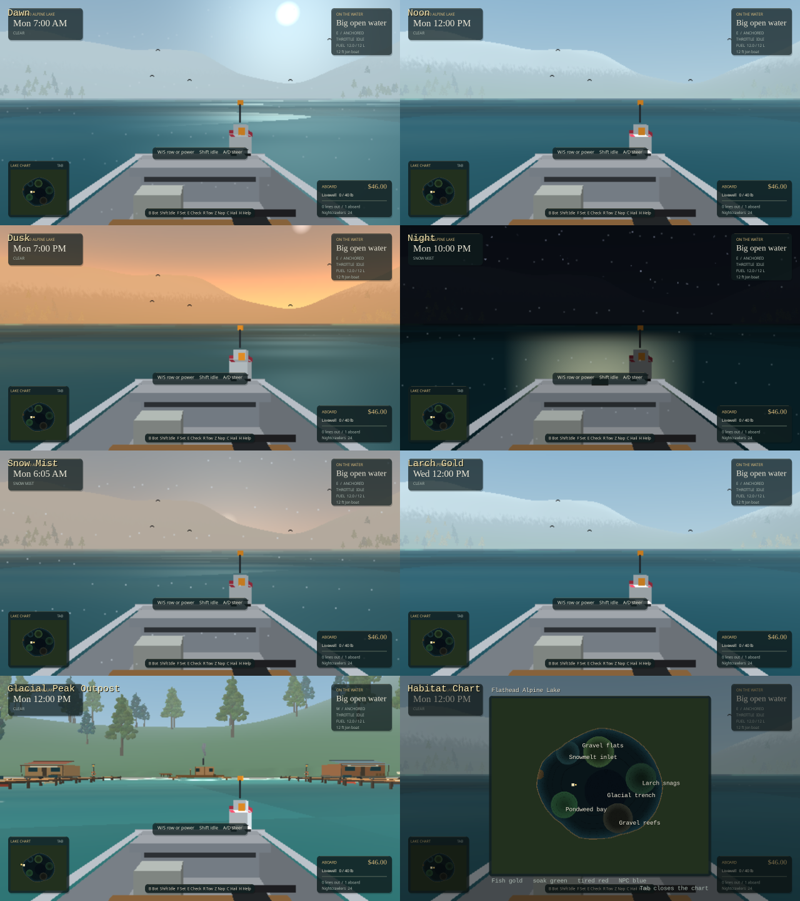

# Flathead Alpine Lake — V1-25 / issue #53

Flathead now loads a procedural alpine lake instead of the flat systems map.
Its six named habitats, collision boundary, chart, depth soundings and both
renderers use the same authored environment in `lakes.json` and baked float32
fields. Briar and Cedar retain their geometry and assets. Crater and Nebula
remain flat maps for their environment tickets. Story advancement and Captain
Huckleberry's actor belong to the later story/cast tickets; existing saved
chapter gates still control travel.

## Map and scenery

- A closed, seventeen-point polar outline covers about **0.975 km²**, or
  **2.27× Briar's water area** (the design target is about 2.2×).
- The 673×545 shore/depth/height grids total **4.4 MB**. The glacial trench
  reaches 45 m; gravel reefs, gravel flats, snowmelt inlet, pondweed bay and
  flooded larch snags have separate depth profiles. Six inland ridges rise
  above 200 m, with snow caps, rocky slopes and a restrained alpine palette.
- Deterministic larch/spruce placements stop below the snow line. Larch Gold
  uses the calendar's Wednesday special and swaps prebuilt colors without
  changing silhouettes, collision, saved state or the fishing RNG. Twelve
  flooded trunks use the existing round-obstacle collision path.
- Glacial Peak Outpost has a clear central launch, piers, moored boats and dry
  shore buildings. A stove chimney and six crossed smoke wisps reuse the
  existing mesh stream. Snow mist adds falling flakes to the weather crossfade;
  the CPU renderer includes simplified snow, ridges and teal water. Reduced
  Motion freezes the new smoke and flakes.
- Alpine ambience routes to the existing synthesized loon calls and a slightly
  stronger larch-wind bed. Swamp frog/cricket cues stay with the older waters.
  No downloaded textures, audio files or persistent particle history are added.

## Validation

`fishing.test_lakegen` covers deterministic finite fields, the area ratio,
scalar/vector habitats, every boat's launch and marina collisions, flooded
trunk obstacles, dry foundations, all six reachable habitats, all 34 species,
non-overlapping chart labels, weather blending, ambience routing, smoke and
Larch Gold, and both rendering paths. Native color swaps preserve the depth
buffer and all persistent resource counts. The existing five-water travel and
save roundtrips still exercise Flathead. The malformed-content probe rejected
96 invalid field/shape combinations without crashing the validator.

[Native catchability witnesses](native/catchability.json) list real, reachable
coordinates, soundings, baits, times and rates for all **34** Flathead species.
The minimum rate/default ratio is **0.70**, above the required 0.5. The flood
uses 4 m cells, the largest current boat's draft and conservative hull clearance,
and accounts for piers and flooded trunks.

The local full suite has the same thirteen Cedar asset errors as the previous
issue because this source export lacks `fishing/assets/cedar.npz`; no replacement
asset is manufactured. Full GitHub `gameplay-tests`, including that unchanged
asset, unit/persistence regressions, narrative checks and the gameplay/software
self-test, is the required complete validation before merge. The inherited Cedar
blob remains `c9df54cbbece17a4b9574ad9bf0ad86a0902d624`.

## Captures and benchmark

Reproduce from the repository root:

```sh
python -m fishing --shots docs/issue-53/native --alpine
python -m fishing --shots docs/issue-53/software --alpine --software
python -m unittest fishing.test_lakegen -v
```

Seed 16 supplies actual scheduled weather: Monday dawn and noon, sunset, a
night, the reserved snow-mist dawn, and Wednesday's clear Larch Gold noon. The
same view and clock are used for both backends; separate views show the Outpost
and habitat chart. Captures are composed at 1280×720 with the game's UI.





The JSON benchmarks include world construction, graphics/foliage setup and the
first rendered frame for load time. They then measure 60 warmed **complete
frames** (render, resize, play/map/Lakes UI) while alternating snow, noon, night
and Larch Gold. Peak RSS includes capture work; steady RSS and resource counts
are recorded before/after the measured loop. Both runs release the active map.

**The native backend here is Mesa llvmpipe, not a hardware GPU.** Its measured
first-frame load is below six seconds; the hardware-GPU six-second acceptance
measurement remains for a machine with a hardware context. Do not interpret
these CPU rasterizer frame times as GPU performance.

| Measurement | Native OpenGL / Mesa | CPU fallback |
| --- | ---: | ---: |
| World construction | 189.0 ms | 194.1 ms |
| Construction through first frame | 1.468 s | 0.545 s |
| Full-frame median / p95 | 140.3 / 174.1 ms | 198.4 / 219.3 ms |
| Peak RSS | 381.9 MiB | 142.2 MiB |
| Persistent graphics objects before / after | 36 / 36 | 0 / 0 |

See [native benchmark](native/benchmark.json) and
[CPU benchmark](software/benchmark.json) for exact measurements.
