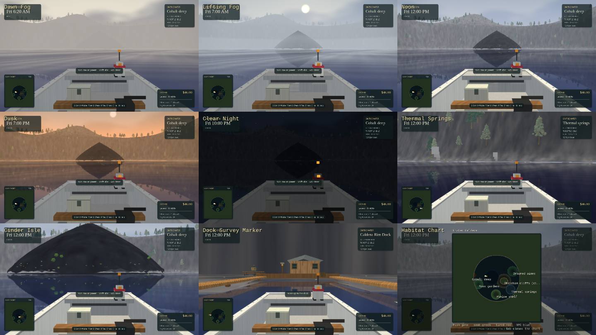
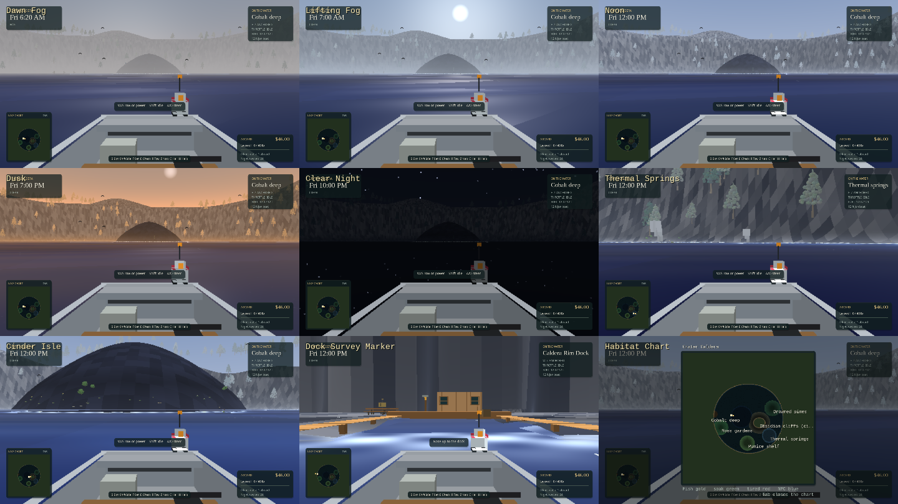

# Crater Caldera — V1-26 / issue #54

Crater now loads a steep procedural caldera with a navigable cinder isle,
thermal springs and Caldera Rim Dock. Physics, soundings, the chart and both
renderers share the authored `lakes.json.environment` fields. Sora's actor,
chapter-four interactions and the travel transition belong to the later cast,
story and Nebula tickets. This environment supplies their physical survey marker
and a read-only clear-night reflection hook; it advances no chapter or unlock.

## Environment

The near-round, roughly 475 m-radius bowl has a steep 125 m rim with varied
ridges above 200 m. A dark obsidian cinder cone sits about 30% off center. Its
elliptical shoreline is part of the same signed-distance texture used by hull
collision, terrain clipping, depth and the chart; boats cannot cross the island.
The 601×601 float32 shore/depth/height fields total about **4.3 MB**. The basin
reaches 60 m, with six distinct fishing habitats: pumice shelf, moss gardens,
drowned pines, the obsidian isle's margin, cobalt deep and thermal springs.

The procedural foliage atlas loads hemlock, whitebark pine and drowned trunks
for this lake. Twelve flooded trunks use the existing round-obstacle collision
path. Pumice details, an indigo depth palette, ash-grey walls and dark obsidian
shore material distinguish it from Flathead. The dock has dry foundations,
solid piers, moored boats and an unobstructed launch. A brass survey plaque and
calibration marks stand beside the service cabin.

Two authored thermal vents produce six crossed steam wisps and two expanding
bubble rings (28 faces total) through the existing bounded ambient mesh stream.
Reduced Motion freezes them. Fog's near-water layer shrinks as the scheduled
forecast clears, revealing the high rim before the water. CPU rendering uses a
simpler height-dependent fog and matching colors.

On clear nights, `caldera.reflection_strength(state, light)` calms the surface
and strengthens the sky mirror. Native rendering samples the existing reflection
pass's depth to keep the rim/island silhouette while painting small celestial
details at full resolution in open-sky reflections. A depth texture replaces
the reflection renderbuffer, keeping the persistent scene object count at 36.
The CPU fallback includes the reflected moon and deterministic star field.
Both use actual forecast lighting and leave story, save and fishing RNG intact.

## Verification

`fishing.test_caldera` covers finite deterministic fields, the rim and island,
all six connected habitats, full hull routes around the island, all boats at
the dock, pier/trunk collisions, dry foundations, the survey geometry, thermal
animation and Reduced Motion, lifting fog, the read-only reflection hook,
validator failures, actual monospace chart-label bounds and both renderers.
The native test preserves scene depth across weather/time changes and checks
reflection depth, stable resources and unclamped floating-point colors in the
actual clear-night branch at idle and under power. All nine existing Flathead tests pass
alongside these nine Crater tests.

[Catchability witnesses](native/catchability.json) cover all **34 Crater fish**
on reachable water with a minimum rate/default ratio of **1.0**. They use the
live species rates, baits, times and depths, with a conservative four-metre
flood from the landing, the largest boat's draft and hull clearance, island,
piers and drowned trunks included.

[Legacy field hashes](legacy-field-hashes.json) record a same-runtime comparison
against PR94's base: Briar and Flathead terrain, chart, shore/depth/coast where
present, props and obstacle arrays remain byte-identical. Cedar's survey and
all other lake definitions are unchanged. The full local suite still requires
the Cedar NPZ missing from this source export; GitHub's complete repository
retains blob `c9df54cbbece17a4b9574ad9bf0ad86a0902d624`. No replacement asset
or test suppression is added. Full push `gameplay-tests` remains required.

## Save recovery after the island arrives

Loading an older Crater save checks deployed rope segments for newly dry land.
A displaced rope moves into the clear launch approach, preserving its length,
deployment ID, mixed baits, hooks, fish, quest history and unknown metadata.
Only coordinates and the rope's current habitat change; the catch's original
observations stay intact. Affected Bot target coordinates follow the same ID.
Wet deployments stay where the player placed them, and saving/reloading is
idempotent. Inventory, livewell capacity and fishing RNG are not used for rescue.

Four persistence regressions cover a buried mixed line with a shiny treasured
fish and future fields, a crossing with both endpoints still wet, an untouched
valid deployment, and six recovered lines on every current boat. Each boat can
reach and pull every rope and then travel away from Crater. This addresses the
P1 save trap raised on the initial PR95 review.

## Captures and budgets

```sh
python -m fishing --shots docs/issue-54/native --caldera
python -m fishing --shots docs/issue-54/software --caldera --software
python -m unittest fishing.test_caldera fishing.test_lakegen -v
```

Seed 4 provides a real clear Friday night and noon. Friday's Fog Lift supplies
06:20 fog, the 07:00 clearing crossfade, then a clear lake. The remaining views
show noon, sunset, the clear-night mirror, thermal springs, the cinder isle,
dock/survey marker and a labelled habitat chart. Every capture pose passes the
actual boat's hull-clear check. Images include the UI at 1280×720.





Each benchmark includes world construction, graphics/foliage setup and the first
frame. After nine warmup frames it measures 60 complete frames (render, resize,
play/map/Lakes UI) across fog, clearing, noon and clear night. It checks the 3 GB
RSS cap, fixed resource counts, six floating-point native scene probes and map
release. Exact load, median/p95, memory and capture weather are in the
[native benchmark](native/benchmark.json) and [CPU benchmark](software/benchmark.json).

**Native evidence here uses Mesa llvmpipe, not a hardware GPU.** The measured
local load is below six seconds; the hardware-GPU six-second acceptance still
needs a hardware context. Frame times here describe CPU rasterization.


| Measurement | Native OpenGL / Mesa | CPU fallback |
| --- | ---: | ---: |
| World construction | 281.2 ms | 214.7 ms |
| Construction through first frame | 1.530 s | 0.575 s |
| Full-frame median / p95 | 99.7 / 110.3 ms | 195.7 / 213.2 ms |
| Peak RSS | 347.9 MiB | 140.6 MiB |
| Persistent scene objects before / after | 36 / 36 | 0 / 0 |
