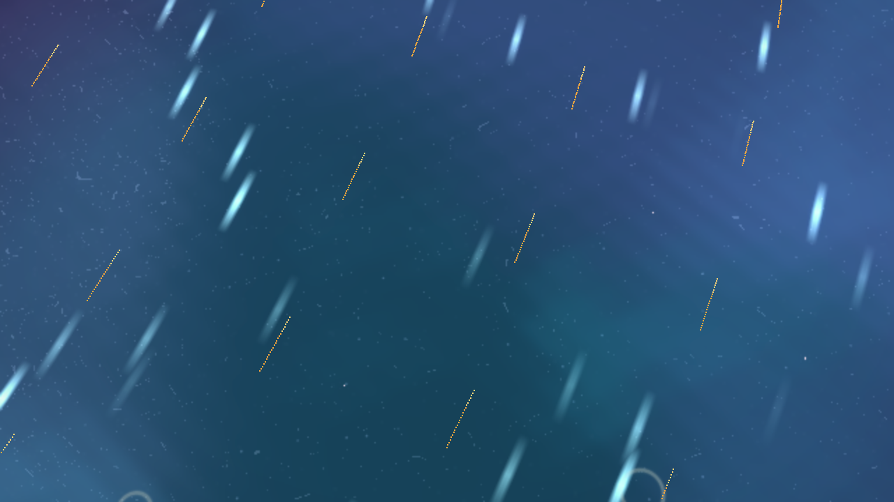
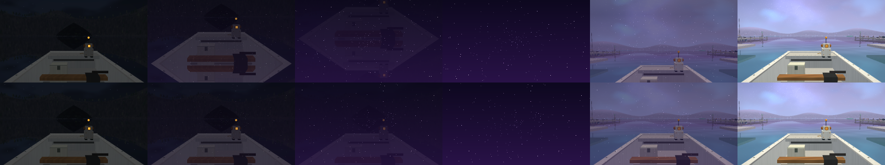
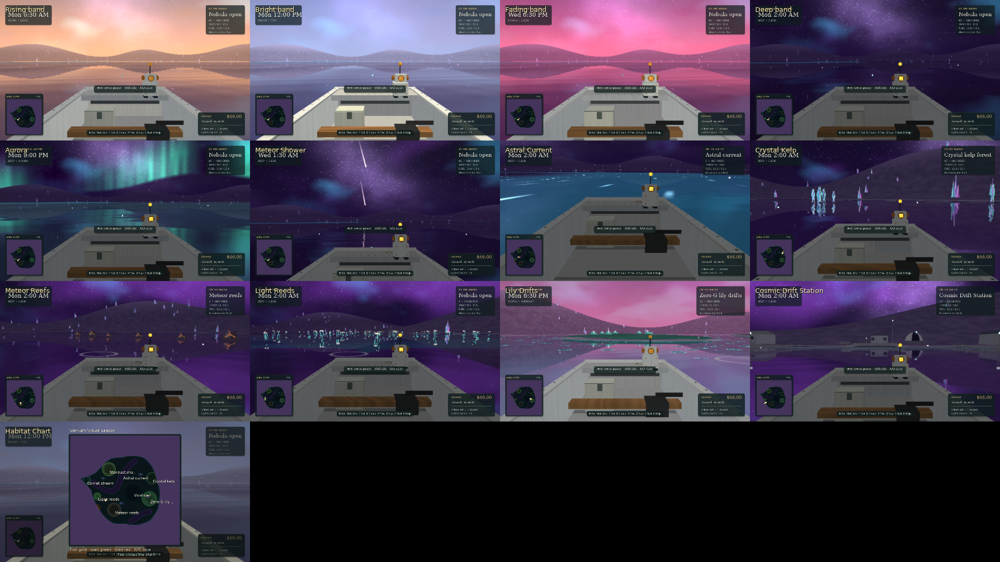
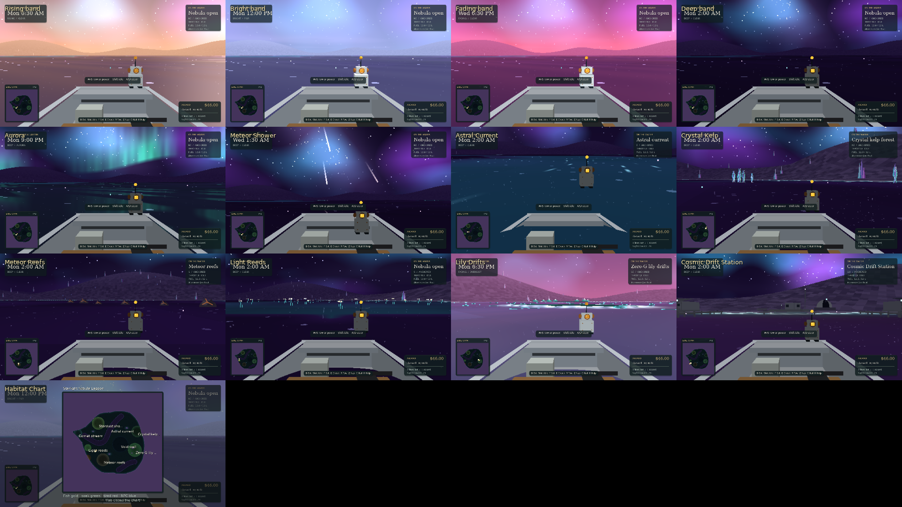

# Starlight Nebula Lagoon — V1-27 / issue #55

The Lagoon is no longer a flat placeholder. It is a separately loaded, driveable
map. Physics, soundings, the chart and both renderers share the authored
`lakes.json.environment` fields. Professor Astra-9 and the finale belong to the
later cast and story tickets. This environment provides Cosmic Drift Station
and the starlight travel transition they will use.

## Environment

The polar shore is irregular, at roughly 500–600 m radius, with the Comet stream
inlet notched into the west bank. The bed is a dark void, with depth
0.9 + 36 × (1 − e^(−d/90)) m at d metres from any bank or drift. It falls to
62 m in the Void well. The 567×567 float32 shore, depth and height grids total
about **3.9 MB**.

Ten habitats use the canonical Nebula labels:
- Cosmic Drift Station
- Comet stream
- Stardust shoals
- Zero-G lily drifts
- Crystal kelp forest
- Meteor reefs
- Void well
- Nebula open
- Light-reeds
- Astral current

**Astral current.** Two current lanes are polylines traced from
`bottools.flow_at`, the same field that drifts lines in a current. Every lane
point becomes a 46 m `current` habitat circle. Each lane segment lies within
12° of the flow at its midpoint, and the lanes run where the field's
streamlines converge. The main lane runs from the Comet stream across the
lagoon to the north-east. The second follows the south-east band.

**Floating lily drifts.** Seven drifts are islands in the shore field, so hulls
collide with them. Open water rings every drift, and star-lilies bloom on each
one.

**Scenery.**
- Crystal kelp: 36 stalks in six clusters, solid.
- Meteor boulders: 18 in three reefs, solid.
- Light-reeds: 70, which never block a hull. Briar's reed crawl speed applies.
- Crystal spires: 110 on the stardust dunes.

Every crystal lights itself. No trees, shore grass, ducks or gulls appear.

**Cosmic Drift Station** keeps the shared landing's dry foundations, solid piers,
moored boats and open launch. Its timber becomes silver-lilac hull panels, and
its lamps become emissive star-lanterns. An observatory dome with a telescope
and a beacon mast stands on the dry pad.

## Sky, aurora and water

The Lagoon keeps the 24-hour clock, but its sky is always starlit (03 §1.6). The
band palettes ease between **Rising**, **Bright**, **Fading** and **Deep**, and the HUD
names the band beside the weather.

The GL sky draws drifting violet and teal gas, a galaxy band, and twinkling
stars at every hour. Overcast hours become a thin lilac stardust haze.

**Aurora.** Aurora is now a real visual weather property that crossfades like
the others. It shows every night from 20:00 to 24:00 and all of Saturday's
Aurora Tide, as animated green-to-magenta curtains with a teal glow on the
water.

**Meteor Shower.** Wednesday's lake day adds its sky show: streaks flying out
from one radiant, which reflect in the water.

**Water.**
- Teal shallows deepen to violet mid-water and a starry void bed.
- The surface is glassy. Open-sky reflections sample the full-resolution sky
  through the reflection pass's depth texture (as at Crater), so the stars, the
  aurora and the meteors all reflect.
- Banks and drifts carry a soft bioluminescent rim, and the zero-G pads glow.
- The stardust shoals glint gold.

**Currents.** The lanes glow teal and quiet the mirror. Each 6 m cell holds one
moving dash that points and travels along `flow_at`, in GLSL (`current_dashes`)
and on the CPU (`nebula.dashes`). Reduced Motion holds every twinkle, curtain,
meteor, dash and star mote still.

## The currents match the flow field

`nebulashots.flow_alignment` checks this on the rendered image:
- The camera looks steeply down over five interior lane points at night.
- The structure tensor of the rendered streaks gives their axis.
- That axis is compared with `flow_at` at the centre of the analysed region,
  foreshortened by the view.

| Lane point | Native error | Native coherence | CPU error | CPU coherence |
| ---: | ---: | ---: | ---: | ---: |
| 4 | 1.45° | 0.78 | 3.38° | 0.38 |
| 8 | 0.90° | 0.55 | 2.54° | 0.47 |
| 12 | 1.25° | 0.63 | 3.57° | 0.38 |
| 16 | 1.01° | 0.70 | 5.35° | 0.52 |
| 20 | 3.30° | 0.52 | 0.35° | 0.59 |

[`current-flow.png`](native/current-flow.png) draws `flow_at` as orange arrows over
the rendered lane; every dash lies along them. `fishing.test_nebula` holds both
renderers to under 15°. It also checks that each dash moves downstream by
exactly its rate × cell per second.



## Starlight travel

Any route to or from the Lagoon tips into starlight (`starlight.py`). The run
loop plays the tip into the reflection from the last lake image. The new lake
loads under the full starfield, then the boat rights itself on the new water and
the HUD returns. The session does not tick during the sequence, and closing the
window still quits.

Reduced Motion plays a still crossfade (lower row below). The strip starts on
Crater's clear still night, where the way is found. Crater's chapter-four
reading can call `starlight.frame` directly.



## Old saves

Loading a save from the flat placeholder map uses Crater's recovery. A rope
buried by a new drift moves into the clear launch approach, keeping its ID,
hooks, catches and length. A boat saved on a drift is eased back into water.
Wet ropes stay where they were, and saving and reloading again changes nothing.

## Verification

`fishing.test_nebula` (19 tests) covers:
- finite, deterministic, bounded fields;
- every habitat and both lanes reachable from the landing;
- all 34 species catchable;
- solid drifts ringed by water;
- station parking and the launch lane for all 24 boats;
- solid kelp and meteors, and pass-through light-reeds with the reed crawl;
- lanes and dashes against the flow field, in both renderers;
- band palettes, starlight at every hour, and the aurora and Meteor Shower
  schedule, all read-only;
- the HUD band label, and one non-overlapping chart label per habitat;
- star motes and Reduced Motion;
- twinkles and a hum with no birds, frogs or crickets;
- the pure transition and the run-loop swap, which plays on Lagoon routes only
  and still quits;
- old-save recovery;
- validator errors.

The native test also checks that GPU resource counts stay fixed across all
bands and the aurora, and that every band's float scene pass is finite.

[Catchability witnesses](native/catchability.json) cover all **34 Nebula fish** on
reachable water, with a minimum rate/default ratio of **1.25** (the aurora
affinity). The selftest still reports 174 lake witnesses and a 0.600× minimum
across every lake.

Briar, Cedar, Flathead and Crater are unchanged. Compared with the base commit
in the same runtime:
- their fields, props, solids, faces and charts are byte-identical;
- their native and CPU frames at dawn, noon and clear night are pixel-identical.

## Captures and budgets

```sh
python -m fishing --shots docs/issue-55/native --nebula
python -m fishing --shots docs/issue-55/software --nebula --software
python -m unittest fishing.test_nebula -v
```

Seed 4 supplies a calm day for each band capture and a real aurora night at
21:00. Wednesday at 01:30 is the Meteor Shower. Each habitat capture shows its
feature from a hull-clear pose, and the set ends with the station at night and a
labelled chart. Images include the UI at 1280×720.





Each benchmark includes world construction, graphics and atlas setup, and the
first frame. After nine warmup frames it measures 60 complete frames (render,
resize, and the play, map and Lakes UI) across all four bands and the aurora.
It also checks:
- the 3 GB RSS cap;
- fixed resource counts;
- ten floating-point native scene probes;
- release of the map.

Exact figures are in the [native benchmark](native/benchmark.json) and the
[CPU benchmark](software/benchmark.json).

**Native evidence here uses Mesa llvmpipe, not a hardware GPU.** The local load
through the first frame is well under six seconds. The hardware-GPU six-second
acceptance still needs a hardware context. Frame times here describe CPU
rasterization.

| Measurement | Native OpenGL / Mesa | CPU fallback |
| --- | ---: | ---: |
| World construction | 468.4 ms | 402.0 ms |
| Construction through first frame | 0.763 s | 0.796 s |
| Full-frame median / p95 | 148.7 / 304.3 ms | 356.4 / 488.6 ms |
| Peak RSS | 337.0 MiB | 168.7 MiB |
| Persistent scene objects before / after | 36 / 36 | 0 / 0 |
